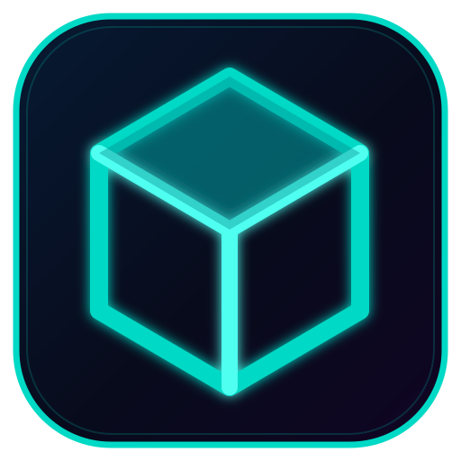

  

# AlphaTrade — Android Market & Portfolio App

An Android application prototype combining market monitoring, portfolio tools, trading workflows, and AI-assisted research.

## Highlights

- Market overview and watchlists
- Portfolio, orders, and analytics screens
- News and AI research interfaces
- Brokerage configuration and integration layer
- Biometric security interface
- Local data and network-service components

## Technology

Kotlin · Jetpack Compose · AndroidX · Room · Retrofit · OkHttp · Firebase AI

## Build

Requirements: Android Studio and a compatible JDK/Android SDK.

1. Clone the repository.
2. Open the project in Android Studio.
3. Sync the Gradle project.
4. Run the `app` module on an emulator or Android device.

## Project Status

A development prototype. The presence of brokerage, AI, or security interfaces does not by itself indicate that live trading, production authentication, or external service integrations are enabled.
